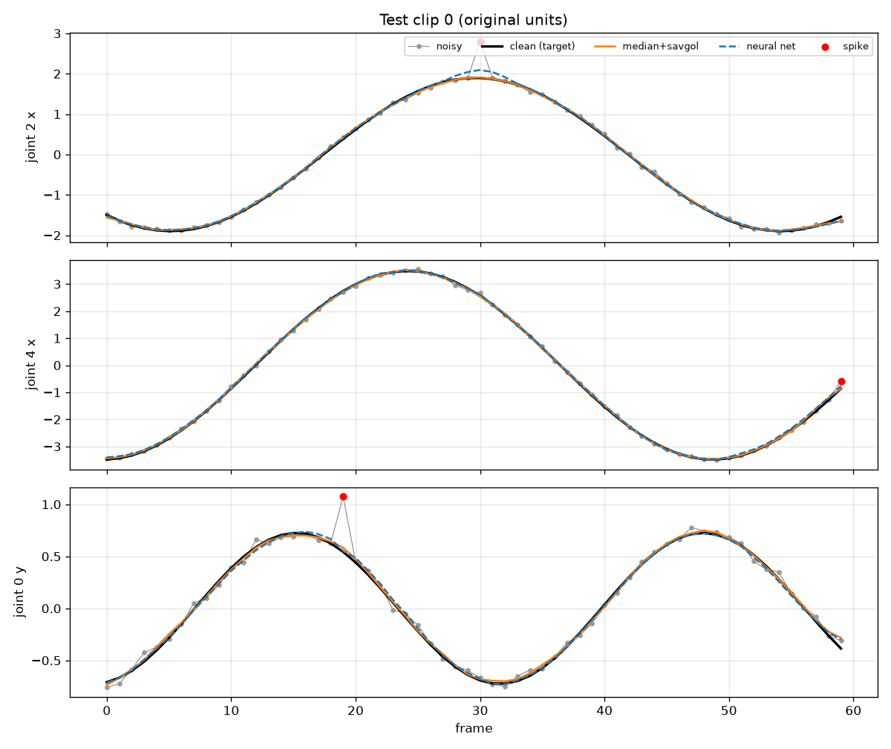
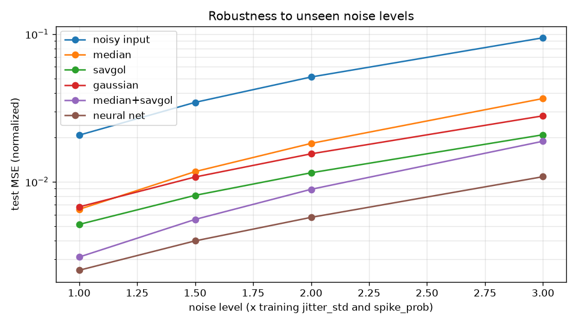
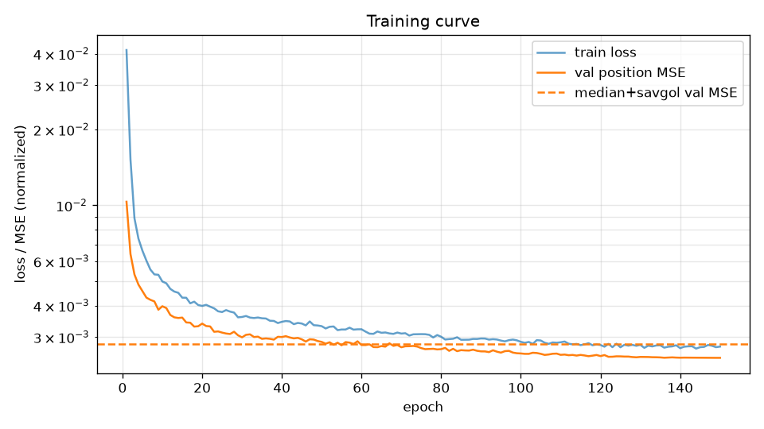

# Motion Capture Denoiser

A 1D convolutional neural network that removes noise from motion-capture joint trajectories, compared honestly against classical signal-processing filters.

Motion-capture data typically has two kinds of noise:

- **Jitter**: small, constant Gaussian noise on every frame (sensor noise).
- **Spikes**: rare, large outliers on single frames (marker swaps and tracking glitches).

Median filters handle spikes well, and smoothing filters handle jitter well. The question this project answers is whether a small neural network can beat a well-tuned combination of the two.

**Result:** on held-out test clips the network beats the best classical baseline (median filter followed by Savitzky-Golay) on every metric. It cuts normalized MSE by 16% and velocity error by 22%, and its lead grows as the noise increases.



## Results

All numbers are from the **test** split, which is used only for final reporting. Baseline settings and the model checkpoint were both chosen on the **validation** split. Lower is better.

| Method | MSE (normalized) | RMSE | RMSE on spikes | RMSE on jitter | Velocity RMSE |
|---|---|---|---|---|---|
| Noisy input (no denoising) | 0.01925 | 0.0718 | 0.4261 | 0.0408 | 0.1015 |
| Median filter (window 3) | 0.00605 | 0.0429 | 0.1571 | 0.0373 | 0.0519 |
| Gaussian filter (σ = 1.0) | 0.00622 | 0.0430 | 0.1787 | 0.0354 | 0.0277 |
| Savitzky-Golay (window 11, order 2) | 0.00469 | 0.0377 | 0.1037 | 0.0351 | 0.0223 |
| Median (3) → Savitzky-Golay (9, 2) | 0.00278 | 0.0299 | 0.0796 | 0.0280 | 0.0187 |
| **Neural net** | **0.00234** | **0.0281** | **0.0757** | **0.0263** | **0.0146** |

What each metric measures:

- **MSE (normalized)**: mean squared error after per-channel standardization. This is the quantity the network is trained on.
- **RMSE**: root-mean-square error in the original coordinate units.
- **RMSE on spikes / on jitter**: RMSE restricted to values hit by a spike (noise larger than 4 jitter standard deviations, about 1.9% of values) or to all other values.
- **Velocity RMSE**: error in frame-to-frame differences. It measures how smooth the output is, which matters for animation even when positions are close.

### Robustness to unseen noise levels

The test clips were re-noised with jitter and spike rate multiplied by 1.5×, 2× and 3×. No method was retrained or re-tuned.

| Method | 1× | 1.5× | 2× | 3× |
|---|---|---|---|---|
| Noisy input | 0.0207 | 0.0345 | 0.0513 | 0.0945 |
| Median → Savitzky-Golay | 0.0031 | 0.0056 | 0.0089 | 0.0188 |
| **Neural net** | **0.0025** | **0.0040** | **0.0057** | **0.0108** |

The values are normalized test MSE. The 1× column uses a fresh noise sample, so it differs slightly from the main table. The network degrades gracefully: its advantage over the best baseline grows from about 19% at the training noise level to about 42% at 3×.



## Method

### Data

The data is synthetic ([src/dataset.py](src/dataset.py)). Each clip has 5 joints × 3 axes = 15 channels over 60 frames. Each channel is a sinusoid with a random frequency, phase and amplitude. Joints further down the chain have larger x-amplitudes, and there is a phase lag between joints, roughly mimicking a swinging limb.

Noise is added on top of the clean clips: Gaussian jitter (σ = 0.04) plus spikes with a 3% chance per value and scale 0.35.

Several details keep the evaluation honest:

- Clean clips are split 70/15/15 into train, validation and test **before** any noise is added, so no clip appears in two splits.
- Normalization statistics are computed on the training clips only.
- Training noise is redrawn every time a clip is read, so the network can't memorize particular noise patterns. Validation and test noise are generated once from a fixed seed, so evaluation is deterministic.

### Baselines

The baselines are in [src/baselines.py](src/baselines.py) and implemented in NumPy: a median filter, a Savitzky-Golay filter, a Gaussian filter, and a median filter followed by Savitzky-Golay.

Each baseline grid-searches its parameters on the validation split, the same tuning budget the network gets through checkpoint selection. Every filter commutes with the per-channel normalization, so filtering normalized data is equivalent to filtering raw data.

### Model

The model is in [src/model.py](src/model.py). It is a fully convolutional residual network with about 101k parameters:

```
input (B, 15, T) ─► 1×1 conv ─► 4 × [dilated conv k=5 ─► GroupNorm ─► GELU ─► 1×1 conv, + skip] ─► 1×1 conv ─► noise estimate
output = input − noise estimate
```

- **It predicts the noise rather than the clean signal.** Noise is small and simple, while the motion itself is large and varied.
- **The output layer starts at zero**, so the untrained network returns its input unchanged and training starts from the "do nothing" baseline.
- **Dilations 1, 2, 4 and 8** give each output frame a view of 61 frames, which covers the whole clip.
- **Edge frames are repeated as padding**, the same way the baselines handle edges, and the network works on clips of any length.

### Training

Training is in [src/train.py](src/train.py). It uses the AdamW optimizer with learning rate 1e-3, weight decay 1e-4, cosine learning-rate decay over 150 epochs, gradient clipping at 1.0, and batch size 32. The checkpoint with the lowest validation loss is kept.

The loss is:

```
loss = MSE(pred, clean) + λ · MSE(Δpred, Δclean)        Δ = difference between consecutive frames, λ = 1.0
```

The velocity term matters a great deal. With position MSE alone, the network won on normalized MSE but **lost to the baseline** on raw RMSE, spike RMSE and velocity RMSE: its output had a small high-frequency wobble that position MSE barely penalizes. Adding the velocity term halved velocity error and made the network win on every metric, at a small cost in normalized MSE.

| Velocity weight λ | MSE (normalized) | Velocity RMSE | Spike RMSE |
|---|---|---|---|
| 0 (position only) | 0.00216 | 0.0308 | 0.1100 |
| 0.5 | 0.00229 | 0.0182 | 0.0808 |
| **1.0 (default)** | 0.00234 | 0.0146 | 0.0757 |
| 2.0 | 0.00240 | 0.0130 | 0.0743 |
| 5.0 | 0.00247 | 0.0111 | 0.0724 |

λ = 1.0 was set as the default before any test results were seen. The table shows the trade-off; it was not used to choose λ.



## Usage

Requires Python 3.10 or newer.

```bash
python -m venv .venv
.venv\Scripts\activate          # Windows; on macOS/Linux: source .venv/bin/activate
pip install -r requirements.txt
```

All commands are run from the repository root:

```bash
python -m src.baselines   # tune the classical filters on val and score them on test
python -m src.train       # train the network (about 2 minutes on CPU); writes outputs/best_model.pt
python -m src.evaluate    # test metrics, robustness sweep and plots; writes to outputs/
pytest                    # 31 tests, about 7 seconds
```

Useful options (run any script with `--help` for the full list):

```bash
python -m src.train --velocity-weight 0              # position-only loss
python -m src.train --epochs 300 --hidden-channels 96
python -m src.train --output-dir outputs/runs/my_run
python -m src.evaluate --checkpoint outputs/runs/my_run/best_model.pt --clip 5
```

## Project structure

```
src/
  dataset.py     synthetic clips, noise model, splits, normalization, DataLoaders
  baselines.py   median / Savitzky-Golay / Gaussian filters and their tuning
  model.py       MotionDenoiser (residual dilated 1D CNN)
  train.py       training loop with velocity loss, checkpointing, early stopping
  evaluate.py    test metrics, robustness sweep, plots
tests/
  test_baselines.py   filter correctness (known S-G weights, spike removal, ...)
  test_pipeline.py    data splits, model, training, metrics, end-to-end train → evaluate
outputs/              checkpoints, results.json and plots (generated)
docs/images/          plots used in this README
requirements.txt      dependencies
pytest.ini            lets plain `pytest` find the src package
```

## Limitations and next steps

- **The data is synthetic and easy.** Smooth sinusoids are far simpler than real human motion. Real motion-capture data also has bone-length constraints, contact with the ground, occluded or missing markers, and noise that is correlated across joints. The natural next step is to train and evaluate on a real dataset such as CMU Mocap, adding synthetic noise to clean recordings.
- **Large spikes on large-amplitude channels are the network's weakest case.** In the example clip, a big spike at a peak of joint 2 x leaves a visible bump. Possible fixes include a robust loss (Huber or L1) or a separate spike-detection step.
- **The headline metric weights all channels equally after normalization.** Small-amplitude channels therefore count as much as large ones. Raw-unit RMSE is reported alongside it for this reason.
- **Each configuration was trained with one seed.** Repeating over several seeds would give error bars on the comparisons.
- **The model only sees 60-frame windows.** Long recordings would need overlapping windows with blending at the boundaries.
